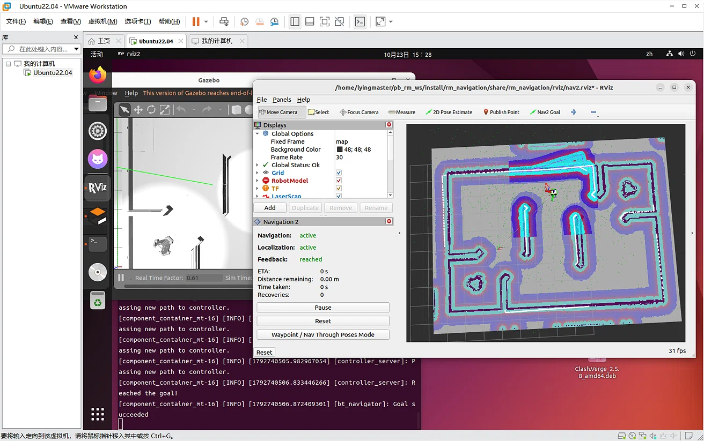
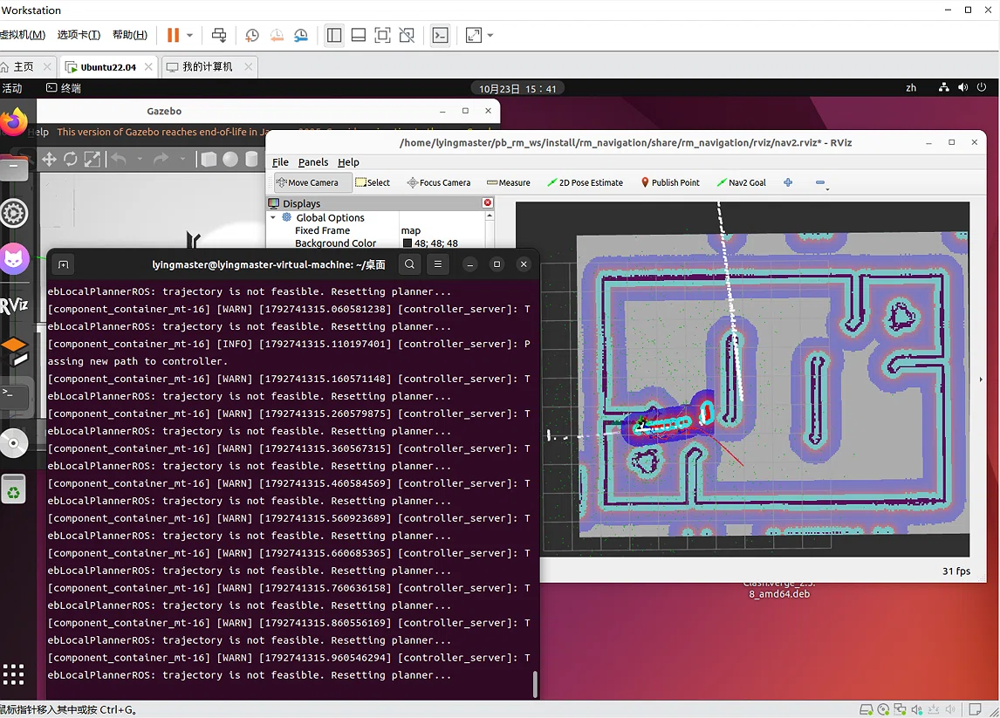
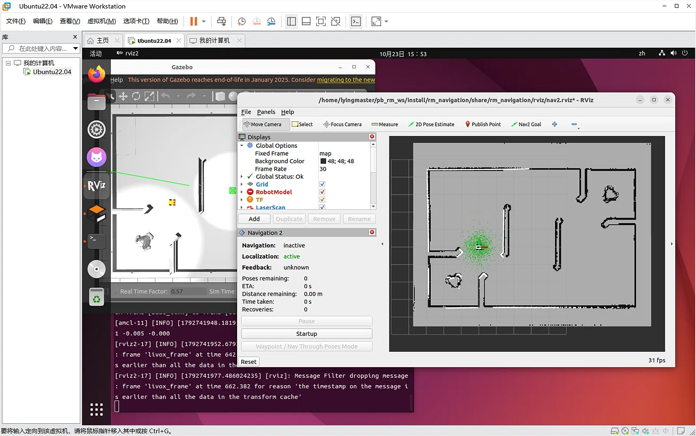
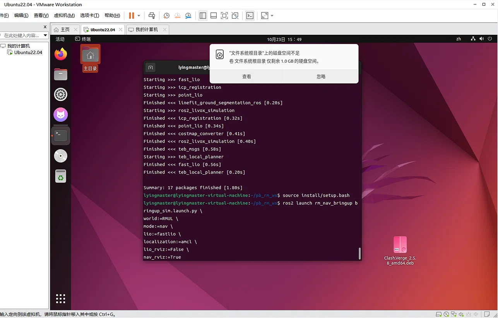

# 2026.10.23  20：56  排错日志  进度总结： 今天光踩坑了，  明天推到重来

# 环境说明
- 主机：Windows 11
- 虚拟机：VMware (Ubuntu 22.04)
- 框架：ROS 2 Humble

# 一 踩坑

# 1. 时间戳问题
在仿真的时候有严重的TF时间延迟问题，一开始寻求AI帮助，改了时间延迟容忍以及控制器，但是效果有限。   
后续在github原文章上看到了DDS的解决方法，但是实际无法使用，可能是改了太多东西导致。现在重装了一个虚拟机，明天重新测试。 
但其实一开始换了amcl算法后是能正常运行的(这个时候的控制器其实是TEB)，只不过后面撞到墙了导致崩溃，后续跟AI改了很多东西后amcl算法直接就用不了了。

<i>图 1：AMCL 算法成功运行，Feedback 显示 reached</i>

<i>图 2：小车撞墙导致系统崩溃</i>

<i>图 3：修改后 AMCL 算法定位发散，彻底无法使用</i>

# 2. 隐藏配置文件与控制器替换
在尝试将默认的 TEB 控制器替换为更轻量的 DWB 时，发现直接用AI的建议修改 `nav2_params.yaml` 无效，后面发现文件路径不一样 `修改了nav2_params_sim.yaml`达成效果，但是替换控制器并没有带来多大提升。这个时候我用的是nav+slam_toolbox，问题还是TF时间戳的问题，我感觉更换DDS应该就能解决了，不需要更换控制器我觉得。

# 3. 源码克隆的死链问题
在重新克隆开源包时，遇到子模块 `costmap_converter` 拉取失败（`Repository not found`），因为原作者仓库地址已失效，手动修改 `.gitmodules` 文件，将 URL 替换为官方源 `rst-tu-docmund/costmap_converter`，并配合 `git submodule sync` 成功拉取全部依赖。有一说一这里要是没AI我自己想搞定那得花不少功夫

# 4.问题总结
最大的问题就是TF时间戳延迟，我感觉我没处理好就是因为太相信AI了，如果老老实实把Github看完应该就没这后续的吊事

后续的问题基本全是基于这个TF时间戳延迟问题展开的，换了amcl算法，改容忍度，提升物理算力，换控制器，最后导致工程文件结构混乱运行不了了直接。 只能重装虚拟机了

<i>图 4：反复折腾导致虚拟机空间不足</i>

# 二 经验总结

不能太过于相信AI，在动手做项目之前要仔细阅读项目流程，在脑子里先过一遍。  进行AI的建议前最好还是到处比对一下。
还有虚拟机的CPU核心数不要给太多了
