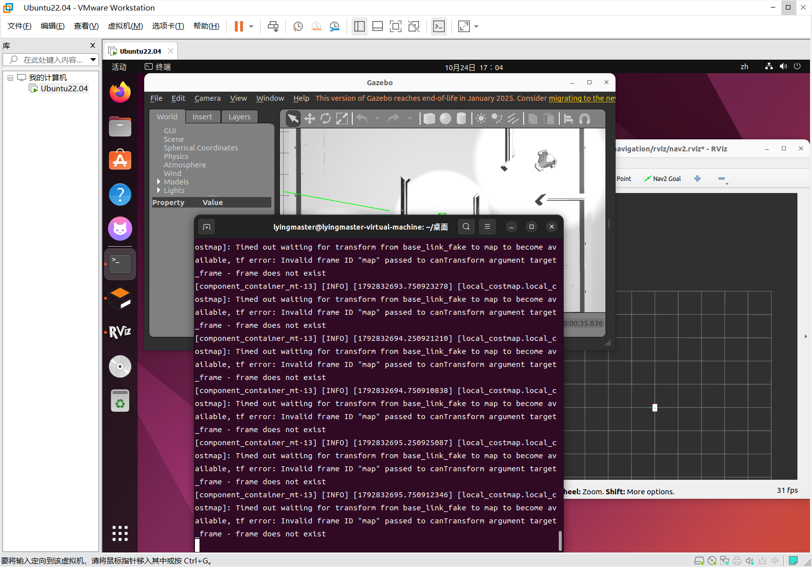

# 2026.10.24    排错日志 

**进度总结：** 今天尝试更换DDS，结果出现新的问题，后面改了一些参数导致小车行动逻辑诡异。

### 环境说明
*   主机： Windows 11 (VMware Workstation)
*   虚拟机：Ubuntu 22.04
*    ROS 2 Humble

---

### 一 踩坑

**1. DDS 与时间戳（TF）的反复拉扯**
今天一开始就照着昨天的想法更换了 **Cyclone DDS**，但后续发现更换后会导致环境紊乱，引发新的问题，评论区的方法也没有解决。后来改回默认 DDS，按照AI的说法找到了 `nav2_params_sim.yaml` 中 `use_sim_time: False` 。将其改为 `True` ，这一步并没明显效果。
  

<i>图1：更换DDS后，无法定位map。</i>

*补充说明：* 其实默认的DDS就没有问题，耐心等待系统初始化后，AMCL 和 slam_toolbox 就能成功定位了。当时 RViz 的全局状态变成了 `Ok`，导航也能跑通。我想尝试在mapping下保存地图，但是每次最后几步的时候小车很大概率会抽风。（这里没还没改工程文件）

**2. 代价地图出界（Out of Bounds）与“无逻辑乱跑”**
在导航测试中，小车会移动一小步就撞墙，终端疯狂报 `Sensor origin at (...) is out of map bounds`。排查发现，Gazebo 仿真环境的右侧存在“虚空”点云，导致 Fast-LIO 定位瞬间漂移，把小车位置“拉”出了局部代价地图的边界。为了追求丝滑轨迹，跟着 AI 的建议去修改了 TEB 控制器的速度、加速度和平滑参数。

*补充说明：* 这步效果很差，白忙活。

---

### 二 经验总结

  **要有备份意识。** 修改文件前，一定要用 Git 或者手动备份。不然出问题就只能删了重来。

   今天进度缓慢，被搞的有点懵，更换DDS反而引出新问题，按照评论区的说法删除海康威视的MVS也没用。换回默认的居然又可用了，mapping和amcl算法下一开始都能正常运行，但小车会莫名其妙的瞬移，撞墙导致崩溃。尝试修改小车的速度让他有反应时间，结果使小车行为诡异。

   不过今天的经历让我对导航的源码和运行有了一定程度的理解，知道一些关键数据代码在哪里，怎么看，怎么改。以及学到了一些工程文件结构。

---
